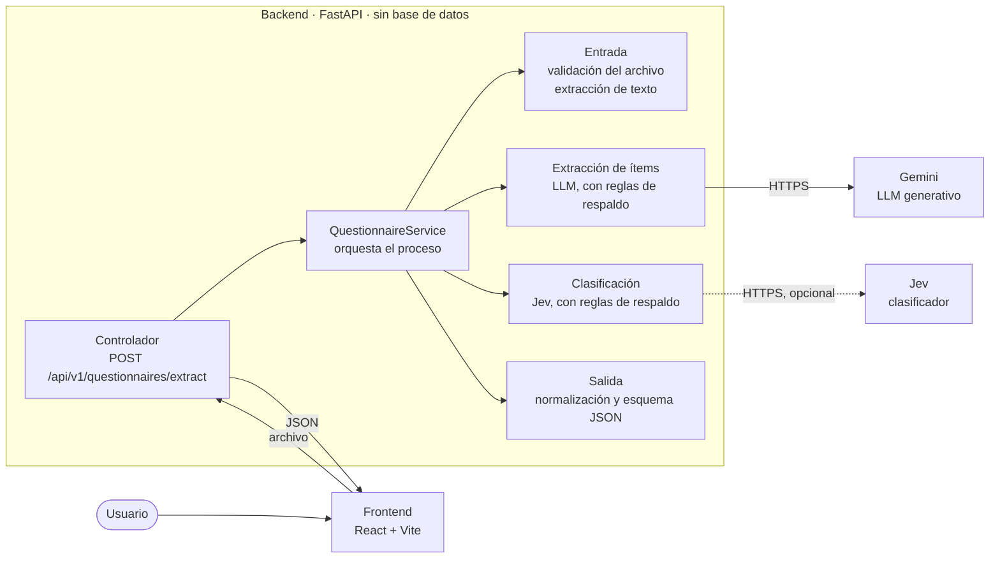
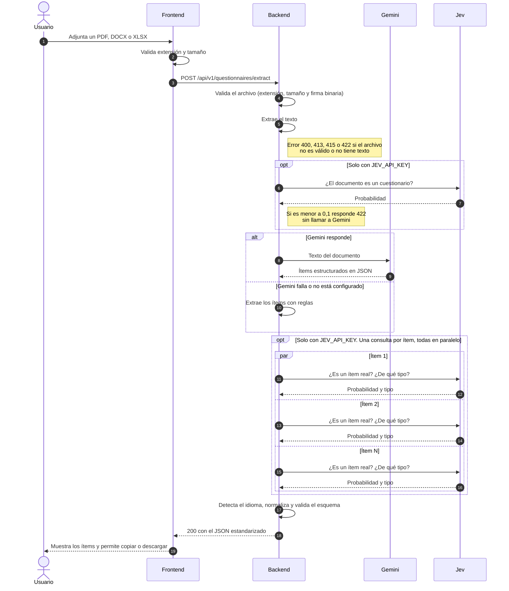

# Extractor de cuestionarios

Aplicación web que recibe un cuestionario en **PDF, Word (.docx) o Excel (.xlsx)** y devuelve sus ítems,
tipos, alternativas y respuestas correctas en un **JSON estandarizado**.

| | URL |
|---|---|
| **Aplicación (frontend)** | https://adipa-interview.vercel.app |
| **API (backend)** | https://adipa-interview-api.vercel.app · documentación interactiva en [`/docs`](https://adipa-interview-api.vercel.app/docs) |

> Ambos corren en el plan gratuito de Vercel. El plan gratuito de Gemini permite 20 peticiones por día;
> si se agotan, la app sigue respondiendo con el extractor por reglas y la UI lo indica.

## Funcionalidades

- Detecta los 5 tipos de ítem: **escala Likert, selección múltiple, verdadero/falso, desarrollo y
  emparejamiento**, con sus alternativas y la respuesta correcta si el documento la indica.
- Detecta el idioma del documento (italiano, español, inglés y otros).
- UI para adjuntar el archivo, procesarlo y ver, copiar o descargar el JSON.
- Errores claros: formato no soportado, archivo dañado, demasiado grande, sin texto o sin ítems.
- Sigue funcionando si la IA falla: un extractor por reglas actúa de respaldo.

## Arquitectura



El backend sigue una arquitectura de **controladores → servicios**, sin capa de repositorios: el
documento se procesa en memoria y no se guarda nada. Cada servicio tiene una sola responsabilidad:

- **Gemini** hace lo que requiere generar: estructurar enunciados, alternativas y respuestas.
- **Jev** toma las decisiones de clasificación: si el documento es un cuestionario, si cada entrada es
  un ítem real y de qué tipo es. Es opcional (línea punteada).
- **Reglas deterministas** respaldan a ambos y garantizan que la salida cumpla siempre el esquema.

```
backend/app/
├── controllers/   endpoints HTTP
├── services/      validación, extracción de texto, LLM, reglas, clasificación (Jev) y normalización
├── schemas/       esquema de salida (Pydantic)
└── core/          configuración, errores y logging
frontend/src/      UI en React
examples/          documentos de prueba y su JSON resultante
```

## Flujo de una petición



Cómo leer el diagrama:

- Los pasos son **secuenciales**, en el orden numerado. Lo único que corre **en paralelo** es la revisión
  de ítems con Jev (bloque `par`): una petición por ítem, hasta 16 a la vez.
- Los bloques `opt` ocurren solo si hay `JEV_API_KEY`. Sin ella, o si Jev no responde, el paso se omite:
  el tipo de cada ítem lo decide Gemini (o las reglas).
- El bloque `alt` es el respaldo: si Gemini falla (cuota, saturación, timeout), los ítems se extraen con
  reglas y la petición igual responde.

### Decisiones de Jev

| Decisión | Resultado |
|---|---|
| ¿El documento es un cuestionario? | Si la probabilidad es menor a 0,1 se responde 422 sin gastar la llamada a Gemini |
| ¿La entrada es un ítem real? | Si es menor a 0,2 se descarta: instrucciones, títulos o campos como "Nombre:" |
| ¿De qué tipo es el ítem? | Elige entre los tipos que permite su estructura; se aplica si la confianza es al menos 0,6 |

Verificado contra la API real con `python -m scripts.check_jev`: 24 de 24 decisiones correctas en
español, italiano e inglés.

## Esquema de salida

```json
{
  "titulo": "Questionario di esempio",
  "idioma": "it",
  "total_items": 1,
  "items": [
    {
      "numero": 1,
      "enunciado": "Quale numero completa la serie: 2, 4, 8, 16, ...?",
      "tipo": "seleccion_multiple",
      "alternativas": [
        { "valor": "A", "texto": "18" },
        { "valor": "B", "texto": "24" },
        { "valor": "C", "texto": "32" }
      ],
      "respuesta_correcta": "C"
    }
  ]
}
```

| `tipo` | `alternativas[].valor` | `respuesta_correcta` |
|---|---|---|
| `escala_likert` | Entero: el del documento o, si no hay, `0, 1, 2…` | Siempre `null` |
| `seleccion_multiple` | Letra `A, B, C…` | Letra (o varias: `"A,C"`) o `null` |
| `verdadero_falso` | `"V"` y `"F"` | `"V"`, `"F"` o `null` |
| `emparejamiento` | Letra de la lista de opciones | Letra o `null` |
| `desarrollo` | `[]` | Respuesta modelo si el documento la trae, si no `null` |

El esquema se valida siempre antes de responder: `total_items` coincide con los ítems, los números son
únicos y la respuesta correcta existe entre las alternativas.

## Instalación local

Requisitos: **Python 3.11+** y **Node.js 22+**.

```bash
# Backend
cd backend
python -m venv .venv
source .venv/bin/activate          # Windows: .venv\Scripts\activate
pip install -r requirements-dev.txt
cp .env.example .env               # completa GEMINI_API_KEY (y opcionalmente JEV_API_KEY)
uvicorn app.main:app --reload --port 8000

# Frontend (en otra terminal)
cd frontend
npm install
cp .env.example .env               # VITE_API_URL=http://localhost:8000
npm run dev                        # http://localhost:5173
```

### Variables de entorno

| Variable | Por defecto | Descripción |
|---|---|---|
| `GEMINI_API_KEY` | — | Key gratuita de [Google AI Studio](https://aistudio.google.com/apikey). Sin ella se usan solo reglas |
| `GEMINI_MODEL` | `gemini-3.5-flash` | Modelo de Gemini |
| `JEV_API_KEY` | — | Opcional. Key de Jev ([console.typesafe.ai](https://console.typesafe.ai)) |
| `CORS_ORIGINS` | `http://localhost:5173` | URL del frontend (separadas por coma) |
| `VITE_API_URL` | `http://localhost:8000` | En `frontend/.env`: URL del backend |

El resto de opciones (umbrales de Jev, timeouts y límites de tamaño) tienen
valores por defecto y están documentadas en [`backend/.env.example`](backend/.env.example). Las API keys
se leen solo de variables de entorno; `.env` está en `.gitignore`.

## API

`POST /api/v1/questionnaires/extract` con el archivo en el campo `file` (`multipart/form-data`):

```bash
curl -F "file=@examples/questionario_benessere_it.pdf" http://localhost:8000/api/v1/questionnaires/extract
```

Responde `200` con el JSON del esquema. Las cabeceras `X-Extraction-Method` (`llm:gemini` o `heuristic`)
y `X-Classifier` (`jev` o `rules`) indican qué se usó. Los errores tienen el formato
`{"error": {"code": "...", "message": "..."}}`:

| HTTP | `code` | Cuándo |
|---|---|---|
| 400 | `invalid_file` | Archivo vacío, dañado, protegido o cuyo contenido no coincide con la extensión |
| 413 | `file_too_large` / `document_too_long` | Archivo de más de 10 MB (4 MB en el despliegue) o texto demasiado extenso |
| 415 | `unsupported_file_type` | Formato distinto de PDF, DOCX o XLSX |
| 422 | `empty_document` | Sin texto extraíble (p. ej. PDF escaneado) |
| 422 | `no_items_detected` | El documento no contiene ítems de cuestionario |
| 502 | `extraction_failed` | Falló la IA y el respaldo por reglas está deshabilitado |

## Tests

```bash
cd backend
pytest                             # 147 tests
```

No usan red: los documentos se generan en memoria y Gemini y Jev se simulan. Cubren la validación de
archivos, el esquema de salida, la extracción de texto, la normalización, los extractores, la integración
con Jev y la API de punta a punta.

## Ejemplos

[`/examples`](examples) contiene tres cuestionarios **inventados** y el JSON resultante de cada uno:

| Archivo | Idioma | Contenido |
|---|---|---|
| `questionario_benessere_it.pdf` | Italiano | Likert, selección múltiple, V/F, desarrollo y hoja de soluciones |
| `cuestionario_habitos_estudio_es.docx` | Español | Likert en tabla, selección múltiple, V/F, emparejamiento y desarrollo |
| `knowledge_quiz_en.xlsx` | Inglés | Hoja con pregunta, tipo, alternativas A–D y respuesta correcta |

Para regenerarlos, desde `backend/`: `python -m scripts.generate_examples` y luego
`python -m scripts.run_examples`.

## Deploy

Desplegado en **Vercel** (plan gratuito) como dos proyectos, cada uno con su `vercel.json`:

- **Backend** (`backend/`): función Python con FastAPI. Variables: `GEMINI_API_KEY`, `JEV_API_KEY`,
  `CORS_ORIGINS` (URL del frontend), `CORS_ORIGIN_REGEX` (las URLs por despliegue que Vercel también
  publica, `https://adipa-interview-[a-z0-9-]+-joseveruttis-projects\.vercel\.app`) y `MAX_FILE_SIZE_MB=4`,
  porque Vercel limita las peticiones a 4,5 MB.
- **Frontend** (`frontend/`): sitio estático de Vite. Variables: `VITE_API_URL` (URL del backend) y
  `VITE_MAX_FILE_SIZE_MB=4`.

```bash
npx vercel deploy --prod --cwd backend
npx vercel deploy --prod --cwd frontend
```

El backend también incluye un `Dockerfile` para desplegarlo en cualquier plataforma de contenedores.

## Supuestos

- **Sin persistencia**: el documento y el resultado viven solo durante la petición.
- **Valores**: letras `A, B, C…` en selección múltiple y emparejamiento, `"V"`/`"F"` en verdadero/falso y
  enteros en Likert; si el documento no numera la escala, se numera desde `0`, como en el enunciado.
- **Emparejamiento**: cada premisa es un ítem cuyas alternativas son todas las opciones de la otra columna.
- **Preguntas Sí/No** se tratan como selección múltiple.
- **Respuesta correcta**: solo si el documento la indica; nunca se deduce resolviendo la pregunta.
- **Numeración**: se conserva la del documento si es única y creciente; si no, se renumera `1..n`.
- **Fuera de alcance**: OCR de PDF escaneados y formatos antiguos `.doc`/`.xls` (el error sugiere
  convertirlos).
- Solo se usan cuestionarios inventados; no se incluye material de tests comerciales ni datos personales.

## Mejoras posibles

- Procesar documentos muy extensos por fragmentos.
- OCR para PDF escaneados.
- Permitir corregir el resultado en la UI antes de exportarlo.
