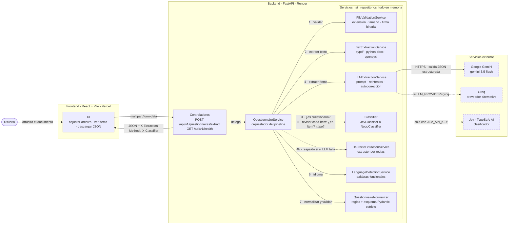
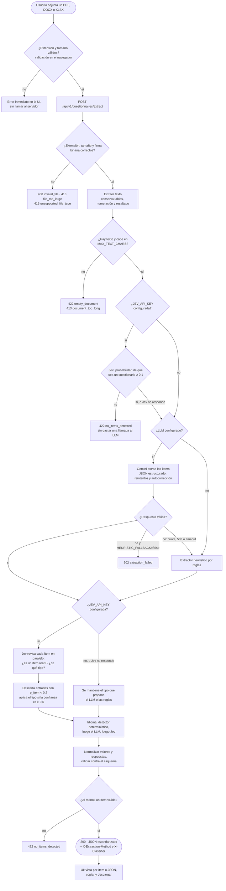

# Extractor de cuestionarios

Aplicación web que recibe un cuestionario en **PDF, Word (.docx) o Excel (.xlsx)** y devuelve sus ítems,
tipos, alternativas y respuestas correctas en un **JSON estandarizado**, listo para cargarse en una
plataforma digital de administración y corrección de pruebas.

| | URL |
|---|---|
| **Aplicación (frontend)** | `https://<pendiente>.vercel.app` |
| **API (backend)** | `https://<pendiente>.onrender.com` · documentación interactiva en `/docs` |

> El backend usa el plan gratuito de Render: tras unos minutos de inactividad se suspende y la primera
> petición puede tardar ~50 s en responder. La UI avisa al usuario cuando esto ocurre.

---

## Funcionalidades

- Subida por arrastrar y soltar o selector de archivos, con validación inmediata en el navegador.
- Detección de los 5 tipos de ítem: **escala Likert, selección múltiple, verdadero/falso, desarrollo y
  emparejamiento**, con sus alternativas.
- Respuesta correcta cuando el documento la indica (clave de respuestas, "Respuesta: B", `*`, ✓, columna
  de respuestas en Excel, alternativa resaltada en Word…).
- Detección del idioma (italiano, español e inglés; también portugués, francés y alemán).
- Vista del resultado por ítem o como JSON, con botones para **copiar** y **descargar**.
- Errores claros: formato no soportado, archivo dañado/disfrazado/protegido, demasiado grande, sin texto
  (PDF escaneado), sin ítems detectables y fallas del proveedor de IA.
- **Resiliencia**: si el LLM no está disponible (cuota agotada, caída o sin API key) se usa un extractor
  basado en reglas, para que el servicio siga respondiendo.
- **Clasificación eficiente con Jev** (opcional): [Jev](https://docs.typesafe.ai) de TypeSafe AI, un
  modelo no generativo especializado en clasificar, toma las decisiones de clasificación en lugar del LLM.
  Decide si el documento es un cuestionario (antes de gastar una llamada a Gemini), el tipo de cada ítem,
  y descarta entradas que no son ítems, como instrucciones o campos personales. Sin su API key, todo
  funciona igual.

## Arquitectura



El backend sigue una arquitectura simple de **controladores → servicios**. No hay capa de repositorios:
el documento se procesa en memoria y nada se almacena. Los números de las flechas indican el orden del
pipeline; las líneas punteadas son dependencias opcionales o de respaldo, y los servicios externos tienen
borde discontinuo.

```
backend/app/
├── main.py                       # App FastAPI: CORS, manejo de errores, logging con request-id
├── dependencies.py               # Composition root: construye los servicios desde la configuración
├── controllers/
│   ├── questionnaire_controller.py   # POST /api/v1/questionnaires/extract
│   └── health_controller.py          # GET  /api/v1/health
├── services/
│   ├── questionnaire_service.py      # Orquesta el pipeline completo
│   ├── file_validation_service.py    # Extensión, tamaño y firma binaria real del archivo
│   ├── text_extraction_service.py    # PDF (pypdf), DOCX (python-docx), XLSX (openpyxl)
│   ├── llm_extraction_service.py     # Prompt, reintentos y autocorrección del JSON del LLM
│   ├── llm/                          # Clientes Gemini y Groq (REST con httpx) y prompts
│   ├── heuristic_extraction_service.py  # Extractor basado en reglas (respaldo)
│   ├── classification/               # Decisiones de clasificación: Jev o clasificador nulo (reglas)
│   ├── normalization_service.py      # Salida cruda → esquema estándar, con reglas deterministas
│   └── language_detection_service.py # Detección de idioma por palabras funcionales
├── schemas/                      # Esquema de salida (estricto) e intermedio (tolerante)
└── core/                         # Configuración, excepciones de dominio y logging
```

### Pipeline de extracción

Recorrido de una petición, con cada punto de decisión y la respuesta de error que produce:



1. **Validación del archivo**: extensión permitida, tamaño máximo y verificación de que los bytes
   correspondan realmente al formato (un `.txt` renombrado a `.pdf` se rechaza).
2. **Extracción de texto** preservando estructura útil: orden real de párrafos y tablas en Word,
   numeración automática de listas (Word no la guarda en el texto), **negrita** y ==resaltado== (pistas
   de respuesta correcta), y filas de tablas/hojas como `celda | celda | celda`.
3. **Filtro "¿es un cuestionario?"** (Jev, si está configurado): si es claramente otro tipo de documento
   se responde `422` sin gastar una llamada al LLM.
4. **Identificación de ítems con LLM** (Gemini por defecto, Groq como alternativa):
   - temperatura 0 y salida JSON estructurada (`responseSchema` en Gemini, modo JSON en Groq);
   - prompt con reglas explícitas por tipo, prohibición de inventar o "resolver" respuestas, y el
     documento delimitado como datos para mitigar *prompt injection*;
   - si el JSON es inválido se reintenta indicándole el error al modelo (autocorrección); errores
     transitorios (red, 5xx) se reintentan con espera; una cuota agotada (429) no se reintenta.
5. **Respaldo heurístico** si el LLM falla o no está configurado (indicado en la cabecera
   `X-Extraction-Method: heuristic` y en la UI).
6. **Revisión de cada ítem con Jev** (si está configurado): descarta lo que no es un ítem y decide el
   tipo; luego se determina el idioma (ver abajo).
7. **Normalización y validación**: reglas deterministas en código (no en el modelo) que garantizan una
   salida consistente sea cual sea el origen; finalmente se valida contra el esquema Pydantic estricto.

Decisión de diseño clave: **el LLM solo propone; el código decide**. La normalización y el esquema
estricto aseguran que la API nunca devuelva un JSON fuera de contrato (p. ej. una respuesta correcta que
no corresponde a ninguna alternativa, o un ítem de desarrollo con alternativas).

### Clasificación con Jev

Clasificar ("¿es X o Y?") no requiere un modelo generativo. Por eso las decisiones de clasificación las
toma [Jev](https://docs.typesafe.ai) (TypeSafe AI), un modelo no generativo que devuelve decisiones
tipadas con probabilidades calibradas y cobra solo la entrada (US$ 0,042 por millón de tokens), muy por
debajo de un LLM. Gemini se ocupa solo de lo que exige generar: estructurar enunciados, alternativas y
respuestas.

| Decisión | Pregunta a Jev | Cuándo |
|---|---|---|
| ¿El documento es un cuestionario? | `noul` (probabilidad sí/no) | Siempre, **antes** del LLM. Si `p < JEV_GATE_THRESHOLD` (0,1) se responde 422 sin llamar al LLM |
| ¿La entrada es un ítem real? | `noul` | Cada ítem extraído. Si `p < JEV_ITEM_THRESHOLD` (0,2) se descarta: instrucciones, títulos o campos personales ("Nombre:", "Fecha:") |
| Tipo del ítem | `choice` entre los tipos que permite su estructura | Cada ítem, en la misma petición que la anterior |
| Idioma | `choice` entre idiomas | Solo si el detector determinístico no tiene señal y el LLM no lo informó |

- **Tipos posibles según la estructura**: con alternativas, selección múltiple, Likert o emparejamiento;
  sin alternativas, desarrollo o verdadero/falso. Si las alternativas son Verdadero/Falso, el tipo
  queda fijo y no se pregunta. El tipo que propone el extractor va primero, porque Jev favorece levemente
  la primera opción.
- **Contexto para emparejamiento**: cada consulta incluye las otras entradas que comparten exactamente
  las mismas alternativas. Medido contra la API: sin ese contexto, Jev clasificaba "Perú" (con capitales
  como opciones) como selección múltiple; con él, como emparejamiento.
- **Opción señuelo** (*autoinforme*) en ítems sin alternativas, para que afirmaciones como "Me siento
  nervioso" no se confundan con verdadero/falso.
- El tipo de Jev se aplica solo si `confidence ≥ JEV_MIN_CONFIDENCE` (0,6); si no, se mantiene el que
  propone el extractor. Una petición por ítem (como recomienda Jev), en paralelo con concurrencia acotada.
- **Fail-open**: sin `JEV_API_KEY`, o si Jev falla (red, 401, 429/529 tras reintentar, respuesta
  inesperada), se usa el tipo que propuso Gemini o las reglas: por eso Gemini sigue devolviendo un tipo.
  Jev nunca hace fallar una petición ni puede dejar el cuestionario vacío. La cabecera `X-Classifier`
  (`jev` o `rules`) y la UI indican qué se usó.

**Resultados medidos contra la API real** (`python -m scripts.check_jev` y pruebas de punta a punta):

| Prueba | Resultado |
|---|---|
| Filtro sobre los 3 ejemplos (es, it, en) | Pasan con p = 0,99–1,00 |
| Filtro sobre textos que no son cuestionarios (informe, receta, factura) | Rechazados con p = 0,01, en ~1 s y sin llamar al LLM (que tarda 11–40 s) |
| Revisión de 15 entradas en es, it, en (tipos, emparejamiento, Sí/No, autoinforme, campos personales, instrucciones) | 15 de 15 correctas. Ítems reales: p_ítem ≥ 0,85; entradas basura: p_ítem ≤ 0,04 |
| Idioma (es, it, en) | 3 de 3 |
| Gemini + Jev sobre los 3 ejemplos | Mismos tipos que la referencia; Jev confirmó los 19 tipos que decidió, sin corregir ninguno |
| LLM caído, encuesta con "Nombre del estudiante:" y "Fecha:" | Solo reglas: salen como preguntas. Con Jev: descartadas (+1,6 s) |
| LLM caído, afirmaciones V/F sin marcar | Solo reglas: desarrollo. Con Jev: verdadero/falso |
| Latencia de Jev | ~1 s para el filtro y ~1–2 s para revisar todos los ítems en paralelo, red incluida |

Para verificar la key y los umbrales contra la API real (desde `backend/`):

```bash
python -m scripts.check_jev
```

El script lista los modelos disponibles para la key y pasa por el filtro los ejemplos y tres textos que
no son cuestionarios. También revisa 15 entradas (ítems de cada tipo y entradas que no son ítems) y
detecta el idioma en español, italiano e inglés, e informa cada acierto o fallo.

## Esquema de salida

Respeta exactamente el formato del enunciado:

```json
{
  "titulo": "Questionario di esempio",
  "idioma": "it",
  "total_items": 1,
  "items": [
    {
      "numero": 1,
      "enunciado": "Quale numero completa la serie: 2, 4, 8, 16, ...?",
      "tipo": "seleccion_multiple",
      "alternativas": [
        { "valor": "A", "texto": "18" },
        { "valor": "B", "texto": "24" },
        { "valor": "C", "texto": "32" }
      ],
      "respuesta_correcta": "C"
    }
  ]
}
```

| `tipo` | `alternativas[].valor` | `respuesta_correcta` |
|---|---|---|
| `escala_likert` | Entero: el valor indicado en el documento o, si no hay, `0, 1, 2…` | Siempre `null` |
| `seleccion_multiple` | Letra mayúscula `A, B, C…` | Letra, o varias separadas por coma (`"A,C"`), o `null` |
| `verdadero_falso` | `"V"` y `"F"` (texto en el idioma del documento) | `"V"`, `"F"` o `null` |
| `emparejamiento` | Letra mayúscula de la columna de opciones | Letra o `null` |
| `desarrollo` | `[]` (sin alternativas) | Respuesta modelo en texto si el documento la trae, si no `null` |

Reglas de validación del esquema: `total_items` coincide con la cantidad de ítems, números de ítem
únicos, `idioma` en ISO 639-1 (o `und` si no se puede determinar), al menos 2 alternativas en ítems
cerrados, valores sin duplicados y respuesta correcta que exista entre las alternativas.

## Instalación local

Requisitos: **Python 3.11+** y **Node.js 22+** (Vite 8).

### Backend

```bash
cd backend
python -m venv .venv
source .venv/bin/activate          # Windows: .venv\Scripts\activate
pip install -r requirements-dev.txt
cp .env.example .env               # y completa GEMINI_API_KEY (o GROQ_API_KEY)
uvicorn app.main:app --reload --port 8000
```

API en `http://localhost:8000` y documentación OpenAPI en `http://localhost:8000/docs`.
Sin API key la aplicación funciona igual, usando solo el extractor heurístico.

### Frontend

```bash
cd frontend
npm install
cp .env.example .env               # VITE_API_URL=http://localhost:8000
npm run dev
```

Aplicación en `http://localhost:5173`.

### Variables de entorno

**Backend** (`backend/.env`; ver `backend/.env.example`):

| Variable | Por defecto | Descripción |
|---|---|---|
| `LLM_PROVIDER` | `gemini` | `gemini`, `groq` o `none` (solo heurístico) |
| `GEMINI_API_KEY` | — | API key gratuita de [Google AI Studio](https://aistudio.google.com/apikey) |
| `GEMINI_MODEL` | `gemini-3.5-flash` | Modelo de Gemini (ver `GET /v1beta/models` para los disponibles) |
| `GROQ_API_KEY` | — | API key gratuita de [Groq](https://console.groq.com/keys) |
| `GROQ_MODEL` | `llama-3.3-70b-versatile` | Modelo de Groq |
| `HEURISTIC_FALLBACK` | `true` | Usar el extractor por reglas si el LLM falla |
| `JEV_API_KEY` | — | Opcional. Key de Jev ([console.typesafe.ai](https://console.typesafe.ai)); también se acepta `TYPESAFE_API_KEY` |
| `JEV_MODEL` | `jev-1.14.0` | Versión de Jev (fijada, porque los umbrales dependen del modelo) |
| `JEV_MIN_CONFIDENCE` | `0.6` | Confianza mínima para aceptar una clasificación de Jev |
| `JEV_GATE_THRESHOLD` | `0.1` | Probabilidad mínima de "es un cuestionario" para llamar al LLM |
| `JEV_ITEM_THRESHOLD` | `0.2` | Probabilidad mínima de "es un ítem real" para conservar una entrada |
| `JEV_TIMEOUT_SECONDS` | `10` | Timeout por llamada a Jev |
| `LLM_TIMEOUT_SECONDS` | `120` | Timeout por llamada al LLM |
| `LLM_MAX_ATTEMPTS` | `2` | Intentos ante JSON inválido o errores transitorios |
| `CORS_ORIGINS` | `http://localhost:5173,…` | Orígenes permitidos, separados por coma |
| `CORS_ORIGIN_REGEX` | — | Regex opcional de orígenes (p. ej. previews de Vercel) |
| `MAX_FILE_SIZE_MB` | `10` | Tamaño máximo del archivo |
| `MAX_TEXT_CHARS` | `120000` | Largo máximo del texto extraído |
| `LOG_LEVEL` | `INFO` | Nivel de logging |

**Frontend** (`frontend/.env`): `VITE_API_URL`, la URL pública del backend.

Las API keys se leen solo de variables de entorno; `.env` está en `.gitignore`.

## Tests

```bash
cd backend
pytest                      # 147 tests
ruff check . && ruff format --check .
```

Cubren la validación de archivos (formatos, tamaño, archivos disfrazados o corruptos), el esquema de
salida (contrato y reglas de coherencia), la extracción de texto de los 3 formatos, la detección de
idioma, la normalización, el extractor heurístico, el servicio LLM (reintentos, autocorrección, cuota)
con los clientes HTTP simulados, y la API de punta a punta (incluido el respaldo heurístico, los códigos
de error y CORS) y la integración con Jev (formato de la API, reintentos, umbrales de confianza,
filtro previo y funcionamiento sin key o con Jev caído). Los tests no usan red: los documentos se generan en memoria y el LLM se simula.

## API

`POST /api/v1/questionnaires/extract`, `multipart/form-data` con el campo `file`.

```bash
curl -F "file=@examples/questionario_benessere_it.pdf" http://localhost:8000/api/v1/questionnaires/extract
```

- `200` → JSON del esquema. Cabeceras: `X-Extraction-Method` (`llm:gemini`, `llm:groq` o `heuristic`),
  `X-Classifier` (`jev` o `rules`), `X-Fallback-Reason` (si se usó el respaldo), `X-Request-ID` y
  `X-Processing-Time-Ms`.
- Errores con cuerpo uniforme `{"error": {"code": "...", "message": "..."}}`:

| HTTP | `code` | Cuándo |
|---|---|---|
| 400 | `invalid_file` | Archivo vacío, dañado, protegido con contraseña o con contenido que no coincide con la extensión |
| 413 | `file_too_large` / `document_too_long` | Supera `MAX_FILE_SIZE_MB` / `MAX_TEXT_CHARS` |
| 415 | `unsupported_file_type` | Extensión distinta de PDF, DOCX o XLSX (con sugerencia para .doc/.xls) |
| 422 | `empty_document` | No hay texto extraíble (p. ej. PDF escaneado) |
| 422 | `no_items_detected` | El documento no contiene ítems de cuestionario (o Jev determinó que no es un cuestionario) |
| 422 | `validation_error` | Falta el campo `file` |
| 502 | `extraction_failed` | Falló el LLM y el respaldo está deshabilitado |

`GET /api/v1/health` → estado del servicio, proveedor LLM y clasificador activos.

## Ejemplos

La carpeta [`/examples`](examples) contiene tres cuestionarios **inventados** (uno por formato e idioma)
y el JSON resultante de cada uno:

| Archivo | Idioma | Contenido |
|---|---|---|
| `questionario_benessere_it.pdf` | Italiano | Likert con leyenda de escala, selección múltiple (incluye opciones en una línea), V/F, desarrollo y hoja de soluciones |
| `cuestionario_habitos_estudio_es.docx` | Español | Likert en tabla, selección múltiple ("Respuesta: b" y alternativa resaltada), V/F, emparejamiento, desarrollo y clave de respuestas |
| `knowledge_quiz_en.xlsx` | Inglés | Hoja con columnas N°, pregunta, tipo, alternativas A–D y respuesta correcta |

Para regenerarlos (desde `backend/`):

```bash
python -m scripts.generate_examples   # vuelve a crear los documentos
python -m scripts.run_examples        # procesa cada documento con el mismo servicio de la API
```

`run_examples` usa el LLM si hay API key configurada; con `--heuristic` fuerza el extractor por reglas.

## Deploy

**Backend → Render** (plan gratuito). El repositorio incluye un blueprint [`render.yaml`](render.yaml):
1. En Render: *New → Blueprint*, conecta el repositorio.
2. Completa las variables secretas: `GEMINI_API_KEY` (y opcionalmente `GROQ_API_KEY` y `JEV_API_KEY`) y `CORS_ORIGINS`
   con la URL del frontend (p. ej. `https://<app>.vercel.app`).
3. El health check usa `/api/v1/health`.

También hay un `backend/Dockerfile` para desplegar en cualquier plataforma de contenedores
(Railway, Fly.io, Cloud Run…).

**Frontend → Vercel**:
1. *Add New → Project*, importa el repositorio y define **Root Directory = `frontend`** (Vercel detecta Vite).
2. Variable de entorno `VITE_API_URL` = URL del backend en Render.

## Supuestos y decisiones

- **Sin persistencia**: el documento y el resultado viven solo durante la petición (no hay base de
  datos ni repositorios, según lo pedido).
- **Valores de las alternativas**: letras `A, B, C…` en selección múltiple y emparejamiento (aunque el
  documento use `a)`, `1)` o viñetas), `"V"`/`"F"` en verdadero/falso y enteros en Likert. Si el
  documento no numera la escala Likert se numera desde `0`, como en el ejemplo del enunciado.
- **Emparejamiento**: cada premisa de la primera columna es un ítem; sus `alternativas` son todas las
  opciones de la segunda columna y `respuesta_correcta` es la letra que le corresponde.
- **Preguntas Sí/No** se tratan como selección múltiple (no son afirmaciones verdaderas/falsas).
- **Respuesta correcta**: solo se informa si el documento la indica explícitamente; nunca se infiere
  resolviendo la pregunta. Si no coincide con ninguna alternativa, se descarta (`null`).
- **Numeración**: se conserva la del documento si es única y creciente; si se repite (p. ej. secciones
  que reinician en 1) o falta, se renumera `1..n`.
- **Idioma**: se detecta en el backend con un detector determinístico; si no hay señal suficiente se
  usa el idioma que propone el LLM y, en último caso, `und`.
- **PDF escaneados**: no se aplica OCR; se informa al usuario que el documento no tiene texto.
- **Formatos antiguos** `.doc`/`.xls` no se soportan; el error sugiere convertirlos.
- Los campos de **datos personales** (nombre, edad, firma) no son ítems: el prompt indica al LLM que
  los excluya.
- Solo se usan cuestionarios inventados; no se incluye material de tests comerciales.

## Limitaciones y mejoras posibles

- Documentos muy extensos (más de `MAX_TEXT_CHARS`) se rechazan; podría procesarse por fragmentos con
  solapamiento y unir los resultados.
- El extractor heurístico cubre los formatos habituales, pero es menos flexible que el LLM (p. ej.
  alternativas numeradas `1)`, `2)` o maquetaciones a varias columnas en PDF).
- OCR para PDF escaneados (p. ej. Tesseract) y extracción de imágenes asociadas a los ítems.
- Indicar al usuario un nivel de confianza por ítem y permitir corregir el resultado antes de exportarlo.
